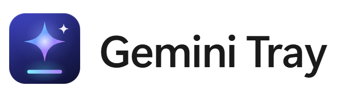
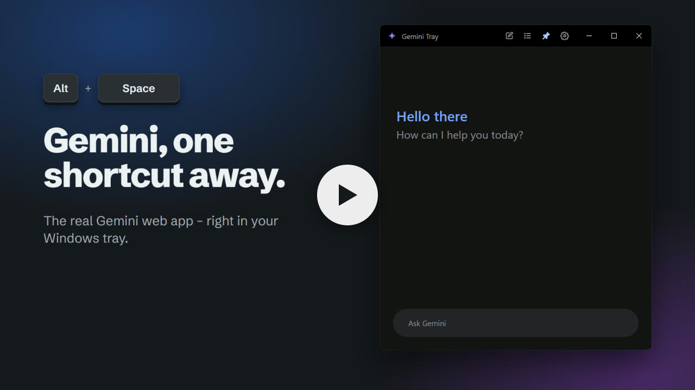
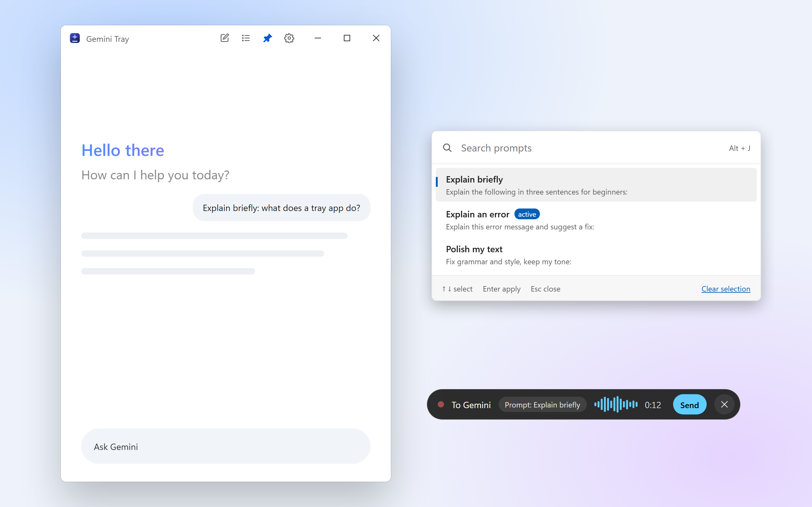
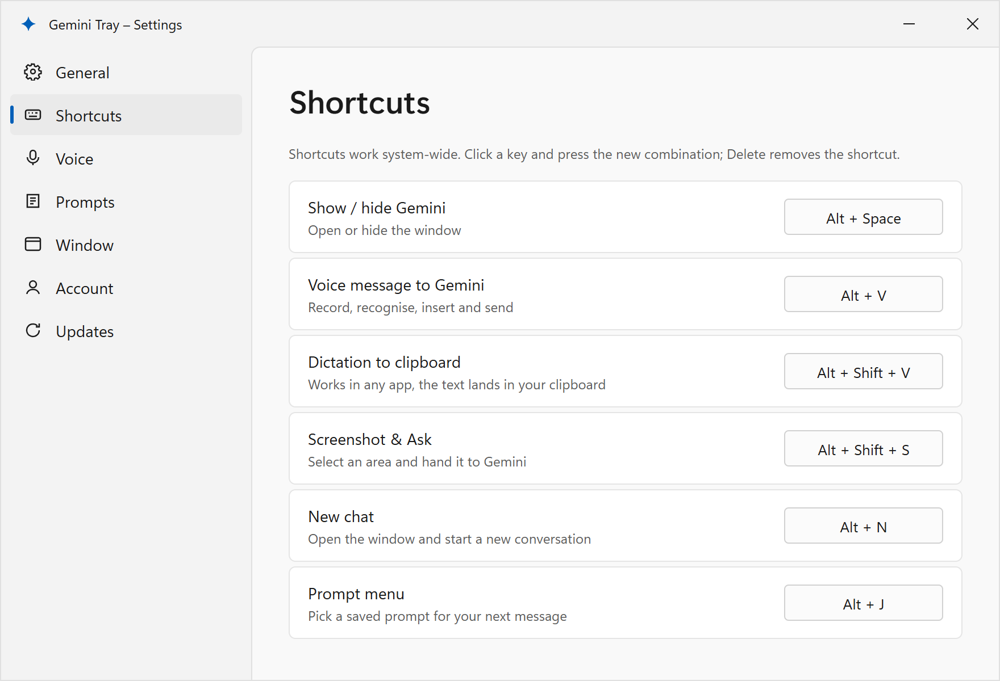
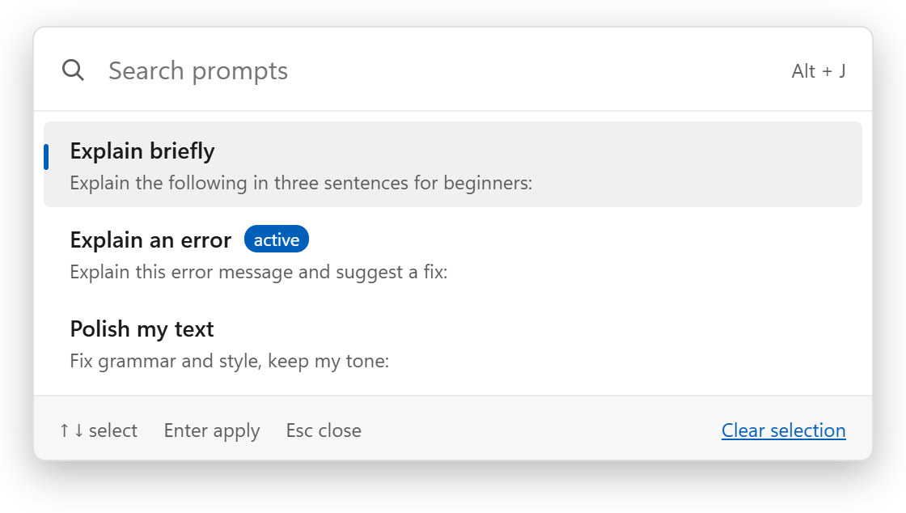
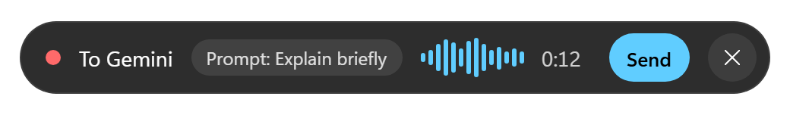
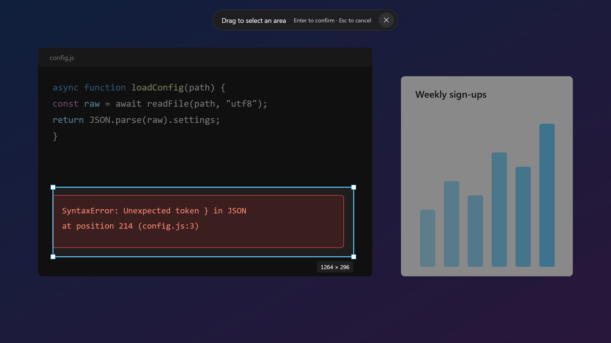
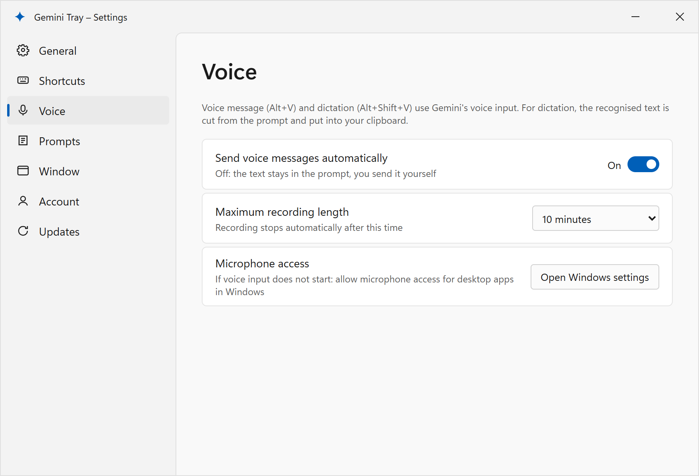
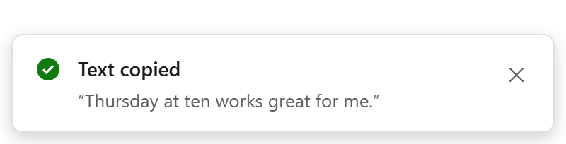

<h1 align="center"><picture><source media="(prefers-color-scheme: dark)" srcset="images/brand/wordmark-dark.png"></picture></h1>

**Google Gemini one shortcut away – with voice input, dictation and Screenshot & Ask, right from the Windows system tray.**

**[Website & video](https://sphaerox.github.io/GeminiTray/)** · **[Download](https://github.com/SphaeroX/GeminiTray/releases/latest)**

<a href="https://sphaerox.github.io/GeminiTray/#video"></a>

Gemini Tray is a small Windows tray app that shows the real Gemini web app (gemini.google.com) in a pop-up window. You use your own Google account and subscription – no API key, no extra costs. Shortcuts, screen capture and the clipboard handling run natively on your PC.

> **Version 2.0 is a complete rewrite** (Tauri instead of Electron). Version 1.x is not updated automatically: uninstall 1.x and install 2.x once.

<!-- screenshots:start -->
<!-- Generated by scripts/screenshots.mjs – do not edit by hand. -->
<p align="center"><picture><source media="(prefers-color-scheme: dark)" srcset="images/screenshots/hero-dark.png"></picture></p>

<table><tr><td width="50%" valign="top"><picture><source media="(prefers-color-scheme: dark)" srcset="images/screenshots/settings-shortcuts-dark.png"></picture><br><sub>Global shortcuts – change any of them</sub></td><td width="50%" valign="top"><picture><source media="(prefers-color-scheme: dark)" srcset="images/screenshots/prompts-dark.png"></picture><br><sub>Prompt menu (Alt+J) – saved prompts for your next message</sub></td></tr><tr><td width="50%" valign="top"><picture><source media="(prefers-color-scheme: dark)" srcset="images/screenshots/indicator-dark.png"></picture><br><sub>Voice message running – Gemini's own speech recognition</sub></td><td width="50%" valign="top"><picture><source media="(prefers-color-scheme: dark)" srcset="images/screenshots/overlay-dark.png"></picture><br><sub>Screenshot & Ask (Alt+Shift+S) – select an area, it lands in your prompt</sub></td></tr><tr><td width="50%" valign="top"><picture><source media="(prefers-color-scheme: dark)" srcset="images/screenshots/settings-voice-dark.png"></picture><br><sub>Voice settings</sub></td><td width="50%" valign="top"><picture><source media="(prefers-color-scheme: dark)" srcset="images/screenshots/toast-dark.png"></picture><br><sub>Dictation (Alt+Shift+V) – the recognised text is in your clipboard</sub></td></tr></table>
<!-- screenshots:end -->

## Features

| Shortcut (default) | Feature |
|---|---|
| `Alt+Space` | Show / hide the Gemini window |
| `Alt+V` | **Voice message** – speak via Gemini's voice input, the message is (optionally) sent |
| `Alt+Shift+V` | **Dictation** – speak via Gemini's voice input, the text is cut from the prompt into your clipboard |
| `Alt+Shift+S` | **Screenshot & Ask** – select a screen area, the image is attached to your Gemini prompt |
| `Alt+N` | New chat |
| `Alt+J` | Prompt menu – pick a saved prompt for your next message |

All shortcuts can be changed in the settings.

- **Voice input**: uses Gemini's own speech recognition (same quality and languages as in the browser). The app switches Gemini's microphone on and off for you and moves the text where it belongs.
- **Full Gemini web experience**: Gems, history, Canvas, Deep Research, image generation – everything the web app offers.
- **Robust by design**: The app only touches the Gemini page through a small bridge (insert/cut text, insert image, send, microphone on/off). If Google changes the page, you get a clear message instead of silent failures – and your dictated text is never lost (it falls back to the clipboard).
- Settings in German and English, light and dark mode (follows Windows), autostart, start minimized, opacity, always on top, automatic updates.

## Installation

Download the latest `Gemini Tray_x.y.z_x64-setup.exe` from the [Releases](https://github.com/SphaeroX/GeminiTray/releases) page and run it. Requirements: Windows 10 or 11 (64-bit). Updates are installed from within the app.

On first start, sign in to your Google account in the Gemini window. If Google refuses the sign-in inside the app, use **Tray menu → Sign in with browser**: Gemini Tray opens Chrome or Edge, you sign in there, and the session is taken over.

## Privacy

- Voice input is processed by Google Gemini, exactly as in the browser.
- Screenshots are only sent to Gemini when you confirm a selection.
- The app has no telemetry. Your Google session is stored in the app's own WebView2 profile in `%LOCALAPPDATA%`.

## Building from source

Prerequisites: [Rust](https://rustup.rs/) (stable, MSVC), [Node.js](https://nodejs.org/) 20+, Visual Studio Build Tools with the "Desktop development with C++" workload, WebView2 runtime (preinstalled on Windows 11).

```powershell
git clone https://github.com/SphaeroX/GeminiTray.git
cd GeminiTray
npm install
npm run tauri dev      # run in development mode
npm test               # run all tests (Vitest + cargo test)
npm run tauri build    # build the installer (src-tauri/target/release/bundle/nsis)
npm run screenshots    # re-capture images/screenshots and the README gallery (needs Microsoft Edge)
npm run site           # build the GitHub Pages website into _site/
```

The screenshots in this README and on the website are generated: the GitHub Action `Screenshots & website` renders the app's own windows (settings, prompt menu, voice indicator, Screenshot & Ask, notifications) with a mocked backend on every change to `main`, commits updated images and publishes `site/` to GitHub Pages.

## Project structure

```
src/            Vue 3 UI for the app's own windows (settings, indicator, prompt menu, overlay, toasts)
site/           Landing page for GitHub Pages (built by scripts/build-site.mjs)
src/bridge/     The Gemini bridge – the only code that touches gemini.google.com
src-tauri/      Rust core: tray, shortcuts, settings, login, voice flow, screenshot, updater
tests/          Test suite (tests/ui: Vitest, tests/rust: cargo integration tests)
Roadmap/        Task-based development roadmap for AI agents
```

## License

MIT – see [LICENSE](LICENSE).
